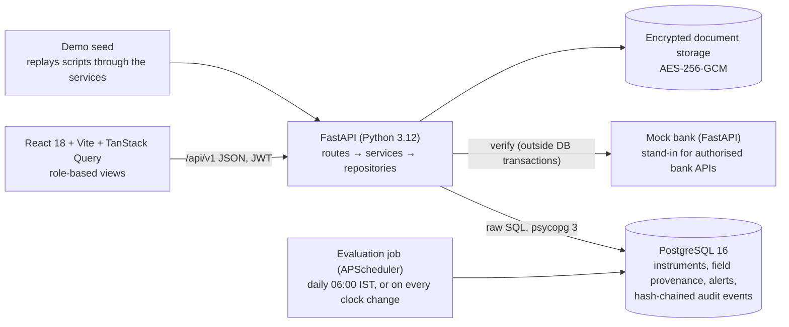

# FDR Portal — Security Deposit / FDR Management for AICTE

Smart India Hackathon · Problem SIH26265 · Smart Automation

A single portal for the whole life of the security deposits and Fixed Deposit Receipts that institutions lodge
with AICTE: submission, bank verification, maturity tracking, renewal, authorised release and a tamper-evident audit.
It answers two questions about every deposit: **how much of this record is proven** (every field is *Claimed by
institution*, *Document-checked* or *Bank-confirmed*), and **what is about to go wrong and who has to act** (a rules
engine on an app clock reminds, escalates what is ignored and blocks releases while problems are open).

## Run it

**Everything in containers** (Docker):

```bash
cp .env.example .env
docker compose up --build          # http://localhost:5173
```

On the first start, with `DEMO_MODE=true` (the default in compose), the backend loads the demo dataset into the empty
database (about 15 s, once the mock bank answers). Nothing else is needed. If your `.env` publishes Postgres on another
host port (e.g. 55432), set `DB_HOST_PORT` there.

**Development** (Node 22, Python 3.12):

```bash
docker compose up -d db
npm install && npm run setup:py   # JS workspaces + .venv with backend and mock bank
npm run dev                       # FastAPI :3000, mock bank :4000, Vite :5173
npm run seed                      # (re)load the demo dataset; needs the mock bank running (npm run dev or npm run dev:bank)
```

Other commands: `npm run test` (pytest against a real Postgres `fdr_test` + vitest), `npm run typecheck` (ruff, mypy
--strict, tsc), `npm run e2e` (clicks through the demo script in Chromium with Playwright and saves screenshots to
`e2e/screenshots/`; needs the stack running and Playwright installed: `npm i -g playwright && npx playwright install chromium`).

**Demo data and the clock.** The seed replays every instrument's history through the real services, so events, the
hash chain, verifications, alerts and escalations are genuine. It leaves the app clock **SIMULATED at today's date** so
the presenter can jump forward; *Reset to today* in the header clock (or `POST /api/v1/clock/reset`) switches it to the
real clock. **Admin → Demo tools** resets the data (your session survives), jumps the clock, corrects a mock bank
record, tampers with the audit log and lists the demo anchors with sample files.

### Secrets

- `JWT_SECRET`: at least 32 characters. Shorter secrets are refused unless `DEMO_MODE=true`.
- `FILE_ENCRYPTION_KEY`: the key that encrypts uploaded documents at rest (AES-256-GCM). It is 32 random bytes,
  base64-encoded. Generate one with
  `python -c "import os,base64;print(base64.b64encode(os.urandom(32)).decode())"` and add it to `.env`.
  Without it, only a `DEMO_MODE` install starts, using a key derived from `JWT_SECRET`. Keep the key: files
  encrypted with it cannot be read without it.

### Verifying a release order from a phone (`PUBLIC_BASE_URL`)

A printed Release / Discharge Order carries a QR code. It encodes `<PUBLIC_BASE_URL>/verify/<order number>`, a public
page (no sign-in) that shows the order number, status, instrument reference, approved date, approver designation and the
audit-log hash, plus "Valid" or "Not found" and nothing else. `PUBLIC_BASE_URL` is read by the backend; when it is not
set it defaults to the first `FRONTEND_ORIGIN` (`http://localhost:5173`), which only works on the machine running the
portal. To scan from a phone during the demo, use the laptop's LAN address instead (phone and laptop on the same
Wi-Fi). Find it with `ipconfig` (Windows, "IPv4 Address"), `ipconfig getifaddr en0` (macOS) or `hostname -I` (Linux),
say `192.168.1.20`, and put this in your local `.env` (not in `.env.example`):

```bash
PUBLIC_BASE_URL=http://192.168.1.20:5173
FRONTEND_ORIGIN=http://localhost:5173,http://192.168.1.20:5173   # the phone's page may call the API
VITE_API_URL=http://192.168.1.20:3000/api/v1                      # the phone cannot reach "localhost"
```

Then restart the stack so the backend and Vite pick it up, and let Vite listen on the network (`npm run dev` runs
Vite on localhost only; start the web part yourself with `npm run dev -w frontend -- --host`). Under Docker the
`frontend` service already listens on all interfaces, but `docker-compose.yml` fixes its `VITE_API_URL` to
`localhost`; override it for your machine in an untracked `docker-compose.override.yml`. Allow ports 5173 and 3000
through the laptop's firewall. Open the
order on the laptop (`/releases/<id>/order`), scan the QR code with the phone and the check page opens. The addresses are
only used inside that Wi-Fi; the portal does not need to be on the internet.

## Demo users (password `Demo@123`)

The login page has "Sign in as" buttons for these in demo mode.

| Role | Email | Who |
|---|---|---|
| Institution | inst1@demo.in … inst12@demo.in | Heads of 12 synthetic institutions (inst1: Vasavi Institute, Hyderabad) |
| Scrutiny officer | officer@demo.in | South-Central & Southern regions |
| Scrutiny officer | officer2@demo.in | Northern & Western regions |
| Competent authority | approver@demo.in | Director, Regulation Bureau |
| Second approver (> ₹50 L) | approver2@demo.in | Deputy Secretary |
| Admin | admin@demo.in | Portal administrator (rules, users, clock, demo tools) |
| Auditor (read-only) | auditor@demo.in | Internal audit |

## The demo

[`docs/demo-script.md`](docs/demo-script.md) is the 8-step, ~6 minute script: submission with a wrong amount → bank
verification catches it → dashboard → +7 day clock jump → escalation → renewal → release blocked, bank correction,
approved → audit integrity and tamper. The dataset and its anchors (A1…A9) are in
[`docs/seed-spec.md`](docs/seed-spec.md). `backend/tests/test_phase09_demo.py` runs the whole script through the API on
every `npm run test`.

## Architecture



- One app clock: every timestamp and business date comes from it, so the demo can move time and the same daily job
  runs in real mode.
- One state machine: instrument statuses change only through `transition()`, which writes a hash-chained audit event.
- Rules (reminder offsets, escalation ladder, required documents, release conditions, approval levels, risk weights)
  live in the `rules` table and are edited in Admin → Rules.

## Docs

- [`docs/requirements-map.md`](docs/requirements-map.md) — the ten expected capabilities mapped to features
- [`docs/integration-contract.md`](docs/integration-contract.md) — what a real bank / PFMS integration implements
- `docs/PROGRESS.md` — build log, deviations and known issues per phase
- `docs/DECISIONS.md` — binding design decisions
- `docs/phases/` — the specification, one file per phase
- `CLAUDE.md` — engineering rules for this repo; `docs/WORKFLOW.md` — how it was built with Claude Code
- `docs/spec/` — original build guide and problem/strategy report

## Honesty notes

- The bank is a **mock service**. It implements the request/response contract a real authorised bank integration would
  (`docs/integration-contract.md`); Indian Overseas Bank is configured as offline and Bank of India as slow, to show
  those paths.
- **All data is synthetic**: institutions, people, deposits, bank letters ("Demo Bank Letter — synthetic data").
- **Improvement metrics are simulated** on the demo data against an assumed manual baseline, and labelled so on every
  screen and export.
- The software supports officials; nothing auto-accepts an instrument or auto-approves a release.
